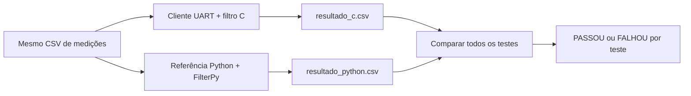

# Filtro de Partículas para STM32F030R8

Implementação de um filtro de partículas para estimar a posição de um objeto em um ambiente retangular. O projeto executa o filtro em uma placa **NUCLEO-F030R8** e utiliza uma implementação em Python como referência para validação.

O firmware recebe deslocamento, ângulo e quatro distâncias por UART, processa uma etapa do filtro e devolve a posição estimada. Cada teste executa uma única etapa independente; antes do teste seguinte, o filtro é reinicializado. A comunicação também pode ser testada sem a placa por meio do Renode.

## Características

- 1.000 partículas;
- mapa de `10 m x 8 m`;
- quatro sensores de distância: paredes esquerda, direita, inferior e superior;
- comunicação UART a `115200 baud`, 8N1;
- referência em Python com NumPy e FilterPy;
- inicialização e movimento pseudoaleatórios reproduzíveis entre C e Python;
- sorteio e reamostragem sistemática executados no próprio firmware;
- coordenadas compactadas em 12 bits para atender ao limite de RAM do STM32F030R8;
- comparação automática de todos os testes executados;
- suporte a teste da UART por TCP usando o Renode.

## Estrutura do projeto

```text
Particle Filter/
├── Core/                       # Firmware e filtro de partículas em C
├── Drivers/                    # HAL e CMSIS fornecidos pela ST
├── Dados_Teste/                # Cenários de entrada para validação
├── Python/
│   ├── particle_filter.py       # Implementação de referência
│   ├── comunicacao_uart.py      # Cliente para placa ou Renode
│   ├── comparar_resultados.py   # Valida C contra Python
│   ├── medicoes.py              # Formato compartilhado das medições
│   └── requirements.txt
├── Renode/                    # Plataforma e scripts de emulação
├── Resultados/                # CSVs gerados (não versionados)
├── executar_teste.py          # Executa C, Python e comparação em sequência
├── listar_portas.py           # Lista as portas seriais disponíveis
├── Particle Filter.ioc         # Configuração do STM32CubeMX
└── STM32F030R8TX_FLASH.ld     # Script de linker
```

A pasta `Resultados` não precisa existir após o clone. Os programas Python a criam automaticamente quando salvam os CSVs.

## Visão geral do funcionamento



Os dois fluxos usam a mesma semente por teste para reproduzir a inicialização e o ruído do movimento. O firmware gera seu próprio sorteio para a reamostragem; a referência usa a função pronta do FilterPy. Como a estimativa é calculada antes da reamostragem e cada teste tem só uma etapa, esses sorteios podem ser diferentes sem afetar a posição comparada. Veja os fluxogramas e a explicação dos testes em [Funcionamento e validação](docs/funcionamento-e-validacao.md).

## Requisitos

### Firmware

- STM32CubeIDE;
- placa NUCLEO-F030R8 e cabo USB, para o teste físico;
- driver do ST-LINK Virtual COM Port, quando necessário.

### Python

- Python 3;
- dependências presentes em `Python/requirements.txt`.

Instale-as a partir da raiz do projeto:

```powershell
py -m pip install -r .\Python\requirements.txt
```

ou

```powershell
python -m pip install -r .\Python\requirements.txt
```

ou

```powershell
python3 -m pip install -r .\Python\requirements.txt
```

### Emulação opcional

- Renode instalado em `C:\Program Files\Renode`.

## Compilar o firmware

1. Abra o STM32CubeIDE.
2. Selecione **File > Import > General > Existing Projects into Workspace**.
3. Escolha a pasta raiz deste repositório.
4. Execute **Project > Clean**.
5. Execute **Build Project**.

O firmware gerado fica em `Debug/Particle Filter.elf`.

## Executar o teste completo com um comando

Depois de compilar o firmware e iniciar o Renode em outro terminal (`py .\Renode\iniciar.py`, ou com `python` ou `python3`), execute na raiz do projeto:

```powershell
py .\executar_teste.py --cenario 20 --modo renode
```

ou, se o comando disponível for `python` ou `python3`:

```powershell
python .\executar_teste.py --cenario 20 --modo renode
```

ou

```powershell
python3 .\executar_teste.py --cenario 20 --modo renode
```

Para usar a placa já gravada, substitua a porta conforme o PC:

```powershell
py .\executar_teste.py --cenario 20 --modo placa --porta COM3
```

ou

```powershell
python .\executar_teste.py --cenario 20 --modo placa --porta COM3
```

ou

```powershell
python3 .\executar_teste.py --cenario 20 --modo placa --porta COM3
```

`--cenario` aceita o número no nome dos arquivos `Dados_Teste/cenario_N_testes.csv` (para 1, `cenario_1_teste.csv`), um identificador de variante como `20-2`, ou o caminho de um CSV. Por exemplo, `--cenario 20` seleciona `Dados_Teste/cenario_20_testes.csv`. Cada linha representa um teste independente de uma etapa. `--modo renode` é o padrão; `--modo placa` usa a detecção automática de porta se `--porta` for omitido. Para alterar o endereço TCP, use `--endereco-renode HOST:PORTA` (padrão: `localhost:12345`). Os caminhos relativos de cenários são resolvidos a partir da raiz do projeto. O script usa `sys.executable` para executar o cliente UART, a referência Python e o comparador **nessa ordem**, com o mesmo interpretador que o iniciou, parando se algum falhar. O script não inicia o Renode nem grava o firmware na placa. Os CSVs em `Resultados/` são sobrescritos.

## Executar na placa

Para listar as portas disponíveis pelo terminal, execute na raiz do projeto:

```powershell
py .\listar_portas.py
```

ou

```powershell
python .\listar_portas.py
```

ou

```powershell
python3 .\listar_portas.py
```

O script chama `comunicacao_uart.py --listar-portas` com o mesmo interpretador Python que o iniciou e mostra a porta e a descrição, como `COM3: STMicroelectronics STLink Virtual COM Port`, quando ela estiver disponível. Ele não abre a porta nem inicia o filtro. As dependências de `Python/requirements.txt` precisam estar instaladas nesse interpretador.

1. Compile o projeto e grave o firmware na NUCLEO-F030R8 pelo STM32CubeIDE.
2. Identifique a porta COM do ST-LINK com `listar_portas.py` ou no Gerenciador de Dispositivos do Windows.
3. Feche outros monitores seriais que estejam usando a mesma porta.
4. Na raiz do projeto, execute com o cenário compartilhado:

```powershell
py .\Python\comunicacao_uart.py --porta COM3 --entradas .\Dados_Teste\cenario_20_testes.csv
```

ou

```powershell
python .\Python\comunicacao_uart.py --porta COM3 --entradas .\Dados_Teste\cenario_20_testes.csv
```

ou

```powershell
python3 .\Python\comunicacao_uart.py --porta COM3 --entradas .\Dados_Teste\cenario_20_testes.csv
```

Substitua `COM3` pela porta correspondente à placa. Para informar as medições manualmente, omita `--entradas`; o programa solicitará o número de testes e, em cada teste de uma etapa:

- deslocamento, em metros;
- ângulo do movimento, em graus;
- distância até as paredes esquerda, direita, inferior e superior, em metros.

Ao final, as respostas da placa são gravadas em `Resultados/resultado_c.csv`.

Se houver somente uma porta serial disponível, ou uma única porta identificada como ST-LINK, também é possível executar sem `--porta`:

```powershell
py .\Python\comunicacao_uart.py
```

ou

```powershell
python .\Python\comunicacao_uart.py
```

ou

```powershell
python3 .\Python\comunicacao_uart.py
```

## Executar com o Renode

Primeiro compile o firmware no STM32CubeIDE. Em um terminal aberto na raiz do projeto, inicie a emulação:

```powershell
py .\Renode\iniciar.py
```

ou

```powershell
python .\Renode\iniciar.py
```

ou

```powershell
python3 .\Renode\iniciar.py
```

O iniciador usa `C:\Program Files\Renode\renode.exe` por padrão. Se necessário, informe `--executavel "caminho\renode.exe"`. Ele copia o ELF compilado para `Renode/firmware.elf`, cria a unidade temporária `R:` e a remove ao encerrar o Renode. A unidade precisa estar livre. Esse iniciador depende do Windows e dos caminhos `R:` usados em `executar.resc`.

Mantenha o Renode aberto. Em outro terminal, execute o cliente por TCP:

```powershell
py .\Python\comunicacao_uart.py --tcp localhost:12345 --entradas .\Dados_Teste\cenario_20_testes.csv
```

ou

```powershell
python .\Python\comunicacao_uart.py --tcp localhost:12345 --entradas .\Dados_Teste\cenario_20_testes.csv
```

ou

```powershell
python3 .\Python\comunicacao_uart.py --tcp localhost:12345 --entradas .\Dados_Teste\cenario_20_testes.csv
```

O cliente usa o mesmo fluxo de entrada e gera o mesmo arquivo `Resultados/resultado_c.csv` usado no teste com a placa.

Antes do primeiro teste, o cliente solicita ao firmware a configuração e mostra `Filtro de Particulas em C`, as dimensões do mapa e as quantidades de partículas e sensores. Recompile e reinicie o firmware depois de atualizar o código, pois o cliente usa o comando `INFO`.

## Executar a referência Python

Na raiz do projeto, execute:

```powershell
py .\Python\particle_filter.py --entradas .\Dados_Teste\cenario_20_testes.csv
```

ou

```powershell
python .\Python\particle_filter.py --entradas .\Dados_Teste\cenario_20_testes.csv
```

ou

```powershell
python3 .\Python\particle_filter.py --entradas .\Dados_Teste\cenario_20_testes.csv
```

Execute primeiro o cliente UART e use o mesmo arquivo indicado a ele. A referência lê as sementes em `Resultados/resultado_c.csv` e confere se as entradas correspondem. Para digitar as medições manualmente, omita `--entradas`, informe o número de testes e depois a mesma sequência de medições utilizada no firmware. O resultado será salvo em `Resultados/resultado_python.csv`. Para usar outro resultado C como registro das sementes, informe `--resultados-c caminho.csv`.

O CSV de entrada contém `teste,deslocamento,angulo,sensor_esquerda,sensor_direita,sensor_inferior,sensor_superior`. A coluna `teste` identifica o teste e deve começar em 1 e ser consecutiva; internamente, cada teste executa somente a etapa 1. Os CSVs de resultado também usam `teste` como primeira coluna. As distâncias estão em metros e o ângulo em graus. As entradas são arredondadas para a resolução do protocolo UART: 1 micrômetro e 1 miligrau. O firmware gera internamente o sorteio da reamostragem.

## Comparar os resultados

Depois de gerar os dois CSVs, execute:

```powershell
py .\Python\comparar_resultados.py
```

ou

```powershell
python .\Python\comparar_resultados.py
```

ou

```powershell
python3 .\Python\comparar_resultados.py
```

O comparador verifica:

- a quantidade e a numeração dos testes;
- se o deslocamento, o ângulo e as quatro leituras de sensores foram iguais;
- se as sementes de cada teste foram iguais;
- se as posições medidas correspondem aos sensores e diferem em no máximo 1 micrômetro, considerando o arredondamento do protocolo UART;
- se as estimativas permanecem dentro do mapa;
- a distância entre as estimativas C e Python em cada teste;
- a diferença máxima e o RMSE do processo completo.

O critério de concordância entre C e Python é uma diferença de no máximo `0,00001 m` (10 micrômetros) **em cada teste de uma etapa**, sempre com as mesmas entradas e a mesma semente. A distância é calculada a partir de `(x_estimado, y_estimado)` dos CSVs. A diferença máxima e o RMSE são apresentados como diagnóstico; o RMSE não é um segundo critério de aprovação. O desvio padrão das diferenças também não substitui a verificação de cada teste: ele pode ser baixo mesmo quando todas as diferenças são grandes. Esse limite compara as implementações; não afirma precisão absoluta de localização nem garante aprovação em qualquer cenário.

`cenario_20_testes.csv` contém 20 testes independentes com movimentos e posições variados, incluindo posições no centro e próximas às paredes. Cada teste reinicializa o filtro e executa apenas a etapa 1. Execute C e Python com o **mesmo** arquivo antes de comparar: os resultados anteriores são sobrescritos em cada execução. Se um teste falhar, investigue a entrada e a causa da divergência antes de rever o critério.

Em cada teste, o cliente UART gera uma semente aleatória de 32 bits usando `secrets.randbits(32)`, envia `RESET,semente` ao firmware e registra a semente na coluna `semente` de `resultado_c.csv`. A referência recupera essa semente para reproduzir a inicialização e o ruído do movimento. Não é necessário gerar outro CSV nem informar a semente manualmente. Os resultados antigos devem ser gerados novamente, pois o cabeçalho mudou.

O firmware gera o ponto inicial da reamostragem com seu gerador pseudoaleatório, após calcular a estimativa. Recalcula e normaliza cada peso durante a seleção, sem guardar um vetor adicional de pesos. O FilterPy realiza seu próprio sorteio no Python. Essa comparação de uma etapa verifica a estimativa anterior à reamostragem; não verifica a igualdade das populações reamostradas. Recompile e carregue o firmware atualizado na placa ou no Renode para usar o protocolo atual.

Para alterar explicitamente o limite por teste:

```powershell
py .\Python\comparar_resultados.py --tolerancia 0.00001
```

ou

```powershell
python .\Python\comparar_resultados.py --tolerancia 0.00001
```

ou

```powershell
python3 .\Python\comparar_resultados.py --tolerancia 0.00001
```

O comparador apresenta `PASSOU` ou `FALHOU` por teste, com o motivo de eventuais falhas, sem emitir um veredito final para o conjunto. A tolerância padrão é `10⁻⁵ m`. Diferença máxima e RMSE são apenas informativos. Para a automação, o programa termina com código `0` quando nenhum teste falha, `1` quando algum teste falha e `2` quando os arquivos ou argumentos são inválidos. Um resultado ausente em um dos CSVs é indicado como falha do teste correspondente.

## Fluxo recomendado de validação

1. Execute o firmware na placa ou no Renode com `--entradas` apontando para um CSV de medições.
2. Execute `particle_filter.py` com o mesmo `--entradas`.
3. Execute `comparar_resultados.py`.
4. Verifique a indicação `PASSOU` ou `FALHOU` e os motivos de falha para cada teste.

## Protocolo de comunicação

O cliente envia comandos ASCII terminados por quebra de linha. Distâncias são transmitidas em micrômetros, ângulos em miligraus e a semente como um inteiro de 32 bits. O sorteio da reamostragem ocorre no próprio firmware.

```text
RESET
RESET,semente_u32
INFO
STEP,etapa,deslocamento_um,angulo_mgraus,esquerda_um,direita_um,inferior_um,superior_um
```

Respostas esperadas:

```text
READY
INFO,largura_um,altura_um,numero_particulas,numero_sensores
RESULT,etapa,x_medido_um,y_medido_um,x_estimado_um,y_estimado_um
```

Normalmente não é necessário enviar esses comandos manualmente, pois `comunicacao_uart.py` implementa todo o protocolo.

`RESET,semente_u32` aceita valores de 0 a 4294967295 e inicializa o teste com essa semente. `RESET` sem parâmetro usa zero somente para a sincronização inicial; cada teste recebe sua própria semente antes do comando `STEP`.
