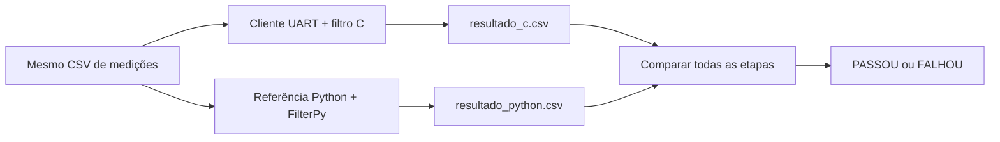

# Filtro de Partículas para STM32F030R8

Implementação de um filtro de partículas para estimar a posição de um objeto em um ambiente retangular. O projeto executa o filtro em uma placa **NUCLEO-F030R8** e utiliza uma implementação em Python como referência para validação.

O firmware recebe deslocamento, ângulo e quatro distâncias por UART, processa uma etapa do filtro e devolve a posição estimada. A comunicação também pode ser testada sem a placa por meio do Renode.

## Características

- 1.000 partículas;
- mapa de `10 m x 8 m`;
- quatro sensores de distância: paredes esquerda, direita, inferior e superior;
- comunicação UART a `115200 baud`, 8N1;
- referência em Python com NumPy e FilterPy;
- inicialização e movimento pseudoaleatórios reproduzíveis entre C e Python;
- mesmo sorteio de início da reamostragem enviado do PC ao firmware;
- coordenadas compactadas em 12 bits para atender ao limite de RAM do STM32F030R8;
- comparação automática de todas as etapas executadas;
- suporte a teste da UART por TCP usando o Renode.

## Estrutura do projeto

```text
Particle Filter/
├── Core/                       # Firmware e filtro de partículas em C
├── Drivers/                    # HAL e CMSIS fornecidos pela ST
├── Dados_Teste/                # Cenários de entrada para validação
│   ├── cenario_1_etapa.csv
│   ├── cenario_5_etapas.csv
│   ├── cenario_10_etapas.csv
│   ├── cenario_20_etapas.csv
│   ├── cenario_25_etapas.csv
│   ├── cenario_50_etapas.csv
│   ├── cenario_100_etapas.csv
│   └── cenario_60_etapas.csv
├── Python/
│   ├── particle_filter.py       # Implementação de referência
│   ├── comunicacao_uart.py      # Cliente para placa ou Renode
│   ├── comparar_resultados.py   # Valida C contra Python
│   ├── medicoes.py              # Formato compartilhado das medições
│   └── requirements.txt
├── Renode/                    # Plataforma e scripts de emulação
├── Resultados/                # CSVs gerados (não versionados)
├── Particle Filter.ioc         # Configuração do STM32CubeMX
└── STM32F030R8TX_FLASH.ld     # Script de linker
```

A pasta `Resultados` não precisa existir após o clone. Os programas Python a criam automaticamente quando salvam os CSVs.

## Visão geral do funcionamento



Os dois fluxos usam a mesma sequência de sorteios para a reamostragem. O cliente envia cada sorteio ao firmware, que executa a reamostragem em C; a referência usa a função pronta do FilterPy. Veja os fluxogramas e a explicação das etapas em [Funcionamento e validação](docs/funcionamento-e-validacao.md).

## Requisitos

### Firmware

- STM32CubeIDE;
- placa NUCLEO-F030R8 e cabo USB, para o teste físico;
- driver do ST-LINK Virtual COM Port, quando necessário.

### Python

- Python 3;
- dependências presentes em `Python/requirements.txt`.

Instale-as a partir da raiz do projeto:

```powershell
python -m pip install -r .\Python\requirements.txt
```

### Emulação opcional

- Renode instalado em `C:\Program Files\Renode`.

## Compilar o firmware

1. Abra o STM32CubeIDE.
2. Selecione **File > Import > General > Existing Projects into Workspace**.
3. Escolha a pasta raiz deste repositório.
4. Execute **Project > Clean**.
5. Execute **Build Project**.

O firmware gerado fica em `Debug/Particle Filter.elf`.

## Executar na placa

1. Compile o projeto e grave o firmware na NUCLEO-F030R8 pelo STM32CubeIDE.
2. Identifique a porta COM do ST-LINK no Gerenciador de Dispositivos do Windows.
3. Feche outros monitores seriais que estejam usando a mesma porta.
4. Na raiz do projeto, execute com o cenário compartilhado:

```powershell
python .\Python\comunicacao_uart.py --porta COM3 --entradas .\Dados_Teste\cenario_20_etapas.csv
```

Substitua `COM3` pela porta correspondente à placa. Para informar as medições manualmente, omita `--entradas`; o programa solicitará, em cada etapa:

- deslocamento, em metros;
- ângulo do movimento, em graus;
- distância até as paredes esquerda, direita, inferior e superior, em metros.

Ao final, as respostas da placa são gravadas em `Resultados/resultado_c.csv`.

Se houver somente uma porta serial disponível, ou uma única porta identificada como ST-LINK, também é possível executar sem `--porta`:

```powershell
python .\Python\comunicacao_uart.py
```

## Executar com o Renode

Primeiro compile o firmware no STM32CubeIDE. Em um terminal PowerShell aberto na raiz do projeto, inicie a emulação:

```powershell
.\Renode\iniciar.ps1
```

Mantenha o Renode aberto. Em outro terminal, execute o cliente por TCP:

```powershell
python .\Python\comunicacao_uart.py --tcp localhost:12345 --entradas .\Dados_Teste\cenario_20_etapas.csv
```

O cliente usa o mesmo fluxo de entrada e gera o mesmo arquivo `Resultados/resultado_c.csv` usado no teste com a placa.

## Executar a referência Python

Na raiz do projeto, execute:

```powershell
python .\Python\particle_filter.py --entradas .\Dados_Teste\cenario_20_etapas.csv
```

Use o mesmo arquivo indicado ao cliente UART. Para digitar as medições manualmente, omita `--entradas` e informe a mesma sequência utilizada no firmware. O resultado será salvo em `Resultados/resultado_python.csv`.

O CSV de entrada contém `etapa,deslocamento,angulo,sensor_esquerda,sensor_direita,sensor_inferior,sensor_superior`. As distâncias estão em metros e o ângulo em graus. As etapas devem começar em 1 e ser consecutivas. As entradas são arredondadas para a resolução do protocolo UART: 1 micrômetro e 1 miligrau. O cliente também envia um sorteio para a reamostragem em cada etapa; esse valor é gerado automaticamente e não precisa constar no CSV de entrada.

## Comparar os resultados

Depois de gerar os dois CSVs, execute:

```powershell
python .\Python\comparar_resultados.py
```

O comparador verifica:

- a quantidade e a numeração das etapas;
- se o deslocamento, o ângulo e as quatro leituras de sensores foram iguais;
- se os sorteios de início da reamostragem foram iguais;
- se as posições medidas correspondem aos sensores e diferem em no máximo 1 micrômetro, considerando o arredondamento do protocolo UART;
- se as estimativas permanecem dentro do mapa;
- a distância entre as estimativas C e Python em cada etapa;
- a diferença máxima e o RMSE do processo completo.

O critério padrão provisório de concordância entre C e Python é uma diferença de no máximo `0,01 m` (1 cm) **em cada etapa**, sempre com as mesmas entradas e os mesmos sorteios da reamostragem. A distância é calculada a partir de `(x_estimado, y_estimado)` dos CSVs. A diferença máxima e o RMSE são apresentados como diagnóstico; o RMSE não é um segundo critério de aprovação, pois o limite em cada etapa já o implica. O desvio padrão das diferenças também não substitui o limite por etapa: ele pode ser baixo mesmo quando todas as diferenças são grandes. O valor de 1 cm não é uma garantia matemática nem um requisito de precisão absoluta da posição estimada. Foi escolhido inicialmente após o cenário de 20 etapas; os cenários de 50 e 100 etapas também passaram, mas não se deve aumentar o limite apenas para fazer um novo cenário passar.

`cenario_60_etapas.csv` é um teste adicional com movimentos diagonais, mudanças bruscas de direção e posições próximas às paredes. Os arquivos de 1, 5, 10, 20, 25, 50 e 100 etapas permitem observar a concordância em durações diferentes. Execute C e Python com o **mesmo** arquivo antes de comparar: os resultados anteriores são sobrescritos em cada execução. Se o teste falhar, investigue a etapa e a causa da divergência antes de rever o critério.

O cliente UART e a referência Python usam a mesma semente do NumPy para gerar o ponto inicial da reamostragem. O firmware executa a reamostragem em C usando o sorteio recebido e preserva a sequência do seu gerador de movimento. Ainda podem ocorrer diferenças nos pesos acumulados e nos índices selecionados por causa da aritmética das duas implementações.

Para alterar explicitamente o limite por etapa no momento do teste:

```powershell
python .\Python\comparar_resultados.py --tolerancia 0.01
```

O programa termina com código `0` quando a validação passa, `1` quando alguma comparação falha e `2` quando os arquivos ou argumentos são inválidos.

## Fluxo recomendado de validação

1. Execute o firmware na placa ou no Renode com `--entradas` apontando para um CSV de medições.
2. Execute `particle_filter.py` com o mesmo `--entradas`.
3. Execute `comparar_resultados.py`.
4. Verifique a indicação `PASSOU` ou `FALHOU` para cada etapa e para o processo completo.

## Protocolo de comunicação

O cliente envia comandos ASCII terminados por quebra de linha. Distâncias são transmitidas em micrômetros, ângulos em miligraus e o sorteio como um inteiro de 53 bits (`reamostragem_u53`). O firmware divide esse inteiro por `2^53` e faz a reamostragem internamente.

```text
RESET
STEP,etapa,deslocamento_um,angulo_mgraus,esquerda_um,direita_um,inferior_um,superior_um,reamostragem_u53
```

Respostas esperadas:

```text
READY
RESULT,etapa,x_medido_um,y_medido_um,x_estimado_um,y_estimado_um
```

Normalmente não é necessário enviar esses comandos manualmente, pois `comunicacao_uart.py` implementa todo o protocolo.
