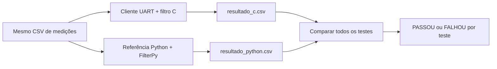

# Filtro de Partículas para STM32F030R8

Implementação de um filtro de partículas para estimar a posição de um objeto em um ambiente retangular. O projeto executa o filtro em uma placa **NUCLEO-F030R8** e utiliza uma implementação em Python como referência para validação.

O firmware recebe deslocamento, ângulo e quatro distâncias por UART, processa uma etapa do filtro e devolve a posição estimada. Cada teste executa uma única etapa independente; antes do teste seguinte, o filtro é reinicializado. A comunicação também pode ser testada sem a placa por meio do Renode.

## Características

- 1.000 partículas;
- mapa de `10 m x 8 m`;
- quatro sensores de distância: paredes esquerda, direita, inferior e superior;
- comunicação UART a `115200 baud`, 8N1;
- referência em Python com NumPy e FilterPy;
- inicialização e movimento pseudoaleatórios reproduzíveis entre C e Python;
- sorteio e reamostragem sistemática executados no próprio firmware;
- coordenadas compactadas em 12 bits para atender ao limite de RAM do STM32F030R8;
- comparação automática de todos os testes executados;
- suporte a teste da UART por TCP usando o Renode.

## Estrutura do projeto

```text
Particle Filter/
├── Core/                       # Firmware e filtro de partículas em C
├── Drivers/                    # HAL e CMSIS fornecidos pela ST
├── Dados_Teste/                # Cenários de entrada para validação
├── Python/
│   ├── particle_filter.py       # Implementação de referência
│   ├── comunicacao_uart.py      # Cliente para placa ou Renode
│   ├── comparar_resultados.py   # Valida C contra Python
│   ├── medicoes.py              # Formato compartilhado das medições
│   └── requirements.txt
├── Renode/                    # Plataforma e scripts de emulação
├── Resultados/                # CSVs gerados (não versionados)
├── Scripts/                   # Automação dos testes e utilitários
│   ├── executar_teste.py       # Executa C, Python e comparação em sequência
│   ├── executar_algoritmo_c.py # Executa somente o filtro C
│   ├── executar_algoritmo_python.py # Executa somente a referência Python
│   ├── executar_comparacao.py  # Compara os resultados existentes
│   └── listar_portas.py        # Lista as portas seriais disponíveis
├── Particle Filter.ioc         # Configuração do STM32CubeMX
└── STM32F030R8TX_FLASH.ld     # Script de linker
```

A pasta `Resultados` não precisa existir após o clone. Os programas Python a criam automaticamente quando salvam os CSVs.

## Visão geral do funcionamento



Os dois fluxos usam a mesma semente por teste para reproduzir a inicialização e o ruído do movimento. O firmware gera seu próprio sorteio para a reamostragem; a referência usa a função pronta do FilterPy. Como a estimativa é calculada antes da reamostragem e cada teste tem só uma etapa, esses sorteios podem ser diferentes sem afetar a posição comparada. Veja os fluxogramas e a explicação dos testes em [Funcionamento e validação](docs/funcionamento-e-validacao.md).

## Requisitos

### Firmware

- STM32CubeIDE;
- placa NUCLEO-F030R8 e cabo USB, para o teste físico;
- driver do ST-LINK Virtual COM Port, quando necessário.

### Python

- Python 3;
- dependências presentes em `Python/requirements.txt`.

Instale-as a partir da raiz do projeto:

```powershell
py -m pip install -r .\Python\requirements.txt
```

ou

```powershell
python -m pip install -r .\Python\requirements.txt
```

ou

```powershell
python3 -m pip install -r .\Python\requirements.txt
```

### Emulação opcional

- Renode instalado em `C:\Program Files\Renode`.

## Compilar o firmware

1. Abra o STM32CubeIDE.
2. Selecione **File > Import > General > Existing Projects into Workspace**.
3. Escolha a pasta raiz deste repositório.
4. Execute **Project > Clean**.
5. Execute **Build Project**.

O firmware gerado fica em `Debug/Particle Filter.elf`.

## Executar o teste completo com um comando

Para escolher as entradas por um menu, execute:

```powershell
py .\Scripts\executar_teste.py
```

ou

```powershell
python .\Scripts\executar_teste.py
```

ou

```powershell
python3 .\Scripts\executar_teste.py
```

O menu oferece entrada manual, execução de um CSV existente e geração automática de testes. Também permite escolher Renode ou placa. No modo manual, informe a quantidade de testes e as medições de cada um uma única vez; o executor salva um cenário e o utiliza no C e na referência Python. Na geração automática, informe apenas a quantidade de testes.

Os cenários manuais e gerados são salvos com nomes exclusivos em `Dados_Teste/`, e apenas o nome do arquivo é mostrado antes da execução. Assim, é possível repetir as mesmas entradas usando `--cenario nome.csv`. As sementes do filtro continuam registradas em `resultado_c.csv`; a referência recupera essas sementes. Ao executar novamente o cliente UART, novas sementes são sorteadas, mesmo se o CSV de entrada for o mesmo.

O repositório inclui apenas `Dados_Teste/cenario_20_testes.csv` como cenário de exemplo. Os demais arquivos dessa pasta são locais e ignorados pelo Git.

Tanto na entrada manual quanto na geração automática, o nome segue `cenario_N_testes.csv`. Se já existir, o executor usa `cenario_N-2_testes.csv`, depois `cenario_N-3_testes.csv` e assim por diante, sem sobrescrever os arquivos existentes. A sequência é compartilhada entre os dois modos. Por exemplo, para 20 testes: `cenario_20_testes.csv`, `cenario_20-2_testes.csv`, `cenario_20-3_testes.csv`. Esses cenários podem ser selecionados com `--cenario 20`, `--cenario 20-2` e `--cenario 20-3`, respectivamente. Para um teste, o nome gerado é `cenario_1_testes.csv`.

A geração automática usa sensores ideais no mapa de 10 × 8 m, com esquerda + direita = 10 m e inferior + superior = 8 m. Sorteia deslocamentos entre 0 e 2 m e ângulos entre 0° e 359,999°, escolhendo posições finais compatíveis com uma origem dentro do mapa. Cada linha é independente e não há ruído adicionado às leituras geradas. Para casos específicos, use a entrada manual ou um CSV conhecido.

Para gerar e executar 20 testes sem passar pelo menu:

```powershell
py .\Scripts\executar_teste.py --gerar-testes 20
```

ou

```powershell
python .\Scripts\executar_teste.py --gerar-testes 20
```

ou

```powershell
python3 .\Scripts\executar_teste.py --gerar-testes 20
```

Use `--manual` para ir diretamente à digitação das entradas. `--manual`, `--gerar-testes N` e `--cenario` são opções alternativas; escolha apenas uma por execução. Sem essas opções, o executor abre o menu. O firmware precisa estar compilado e ativo no Renode ou na placa antes do processamento.

Depois de compilar o firmware e iniciar o Renode em outro terminal (`py .\Renode\iniciar.py`, ou com `python` ou `python3`), execute na raiz do projeto:

```powershell
py .\Scripts\executar_teste.py --cenario 20 --modo renode
```

ou, se o comando disponível for `python` ou `python3`:

```powershell
python .\Scripts\executar_teste.py --cenario 20 --modo renode
```

ou

```powershell
python3 .\Scripts\executar_teste.py --cenario 20 --modo renode
```

Para usar a placa já gravada, substitua a porta conforme o PC:

```powershell
py .\Scripts\executar_teste.py --cenario 20 --modo placa --porta COM3
```

ou

```powershell
python .\Scripts\executar_teste.py --cenario 20 --modo placa --porta COM3
```

ou

```powershell
python3 .\Scripts\executar_teste.py --cenario 20 --modo placa --porta COM3
```

`--cenario` e a opção de CSV existente no menu aceitam um número como `250`, uma variante como `20-2`, o nome `cenario_250_testes` ou `cenario_250_testes.csv`, ou o caminho de um CSV. Nomes sem diretório são procurados em `Dados_Teste/`, e a extensão `.csv` é acrescentada quando omitida. Se o nome não existir nessa pasta, o executor também verifica a raiz do projeto. Caminhos relativos com diretório são resolvidos a partir da raiz do projeto. Cada linha representa um teste independente de uma etapa. Nos comandos diretos, `--modo renode` é o padrão; no menu, o executor pergunta o destino. `--modo placa` usa a detecção automática de porta se `--porta` for omitido. Para alterar o endereço TCP, use `--endereco-renode HOST:PORTA` (padrão: `localhost:12345`). O script usa `sys.executable` para executar o cliente UART, a referência Python e o comparador **nessa ordem**, com o mesmo interpretador que o iniciou, parando se algum falhar. O script não inicia o Renode nem grava o firmware na placa. Os CSVs em `Resultados/` são sobrescritos.

## Executar cada parte separadamente

Para executar somente C, depois somente Python e por fim a comparação:

```powershell
py .\Scripts\executar_algoritmo_c.py
py .\Scripts\executar_algoritmo_python.py
py .\Scripts\executar_comparacao.py
```

ou

```powershell
python .\Scripts\executar_algoritmo_c.py
python .\Scripts\executar_algoritmo_python.py
python .\Scripts\executar_comparacao.py
```

ou

```powershell
python3 .\Scripts\executar_algoritmo_c.py
python3 .\Scripts\executar_algoritmo_python.py
python3 .\Scripts\executar_comparacao.py
```

O script C oferece o mesmo menu e os mesmos argumentos de `executar_teste.py`, incluindo `--cenario 20`, `--manual`, `--gerar-testes N`, `--modo placa --porta COM3` e `--endereco-renode HOST:PORTA`. Ele executa somente o cliente UART e grava `resultado_c.csv`; o firmware precisa estar ativo na placa ou no Renode.

Por padrão, o script Python repete as entradas e sementes de `Resultados/resultado_c.csv`, sem pedir as medições novamente. Ele não executa o C nem a comparação. É necessário ter um resultado C válido anterior. Opcionalmente, use `--cenario nome.csv` para conferir e executar o cenário usado no C, `--manual` para digitar as mesmas entradas, ou `--resultados-c caminho.csv` para selecionar outro registro C. A referência recebe `--repetir-c` quando o script é iniciado sem `--cenario` ou `--manual`.

O script de comparação lê os dois CSVs já existentes, sem executar nenhum filtro. Ele aceita os parâmetros do comparador, como `--tolerancia 0`. Os três scripts usam o mesmo interpretador Python que os iniciou e retornam `0` quando concluem ou `1` em caso de erro.

## Executar na placa

Para listar as portas disponíveis pelo terminal, execute na raiz do projeto:

```powershell
py .\Scripts\listar_portas.py
```

ou

```powershell
python .\Scripts\listar_portas.py
```

ou

```powershell
python3 .\Scripts\listar_portas.py
```

O script chama `comunicacao_uart.py --listar-portas` com o mesmo interpretador Python que o iniciou e mostra a porta e a descrição, como `COM3: STMicroelectronics STLink Virtual COM Port`, quando ela estiver disponível. Ele não abre a porta nem inicia o filtro. As dependências de `Python/requirements.txt` precisam estar instaladas nesse interpretador.

1. Compile o projeto e grave o firmware na NUCLEO-F030R8 pelo STM32CubeIDE.
2. Identifique a porta COM do ST-LINK com `Scripts/listar_portas.py` ou no Gerenciador de Dispositivos do Windows.
3. Feche outros monitores seriais que estejam usando a mesma porta.
4. Na raiz do projeto, execute com o cenário compartilhado:

```powershell
py .\Python\comunicacao_uart.py --porta COM3 --entradas .\Dados_Teste\cenario_20_testes.csv
```

ou

```powershell
python .\Python\comunicacao_uart.py --porta COM3 --entradas .\Dados_Teste\cenario_20_testes.csv
```

ou

```powershell
python3 .\Python\comunicacao_uart.py --porta COM3 --entradas .\Dados_Teste\cenario_20_testes.csv
```

Substitua `COM3` pela porta correspondente à placa. Para informar as medições manualmente, omita `--entradas`; o programa solicitará o número de testes e, em cada teste de uma etapa:

- deslocamento, em metros;
- ângulo do movimento, em graus;
- distância até as paredes esquerda, direita, inferior e superior, em metros.

Ao final, as respostas da placa são gravadas em `Resultados/resultado_c.csv`.

Se houver somente uma porta serial disponível, ou uma única porta identificada como ST-LINK, também é possível executar sem `--porta`:

```powershell
py .\Python\comunicacao_uart.py
```

ou

```powershell
python .\Python\comunicacao_uart.py
```

ou

```powershell
python3 .\Python\comunicacao_uart.py
```

## Executar com o Renode

Primeiro compile o firmware no STM32CubeIDE. Em um terminal aberto na raiz do projeto, inicie a emulação:

```powershell
py .\Renode\iniciar.py
```

ou

```powershell
python .\Renode\iniciar.py
```

ou

```powershell
python3 .\Renode\iniciar.py
```

O iniciador usa `C:\Program Files\Renode\renode.exe` por padrão. Se necessário, informe `--executavel "caminho\renode.exe"`. Ele copia o ELF compilado para `Renode/firmware.elf`, cria a unidade temporária `R:` e a remove ao encerrar o Renode. A unidade precisa estar livre. Esse iniciador depende do Windows e dos caminhos `R:` usados em `executar.resc`.

Mantenha o Renode aberto. Em outro terminal, execute o cliente por TCP:

```powershell
py .\Python\comunicacao_uart.py --tcp localhost:12345 --entradas .\Dados_Teste\cenario_20_testes.csv
```

ou

```powershell
python .\Python\comunicacao_uart.py --tcp localhost:12345 --entradas .\Dados_Teste\cenario_20_testes.csv
```

ou

```powershell
python3 .\Python\comunicacao_uart.py --tcp localhost:12345 --entradas .\Dados_Teste\cenario_20_testes.csv
```

O cliente usa o mesmo fluxo de entrada e gera o mesmo arquivo `Resultados/resultado_c.csv` usado no teste com a placa.

Antes do primeiro teste, o cliente solicita ao firmware a configuração e mostra `Filtro de Particulas em C`, as dimensões do mapa e as quantidades de partículas e sensores. Recompile e reinicie o firmware depois de atualizar o código, pois o cliente usa o comando `INFO`.

## Executar a referência Python

Na raiz do projeto, execute:

```powershell
py .\Python\particle_filter.py --entradas .\Dados_Teste\cenario_20_testes.csv
```

ou

```powershell
python .\Python\particle_filter.py --entradas .\Dados_Teste\cenario_20_testes.csv
```

ou

```powershell
python3 .\Python\particle_filter.py --entradas .\Dados_Teste\cenario_20_testes.csv
```

Execute primeiro o cliente UART e use o mesmo arquivo indicado a ele. A referência lê as sementes em `Resultados/resultado_c.csv` e confere se as entradas correspondem. Para digitar as medições manualmente, omita `--entradas`, informe o número de testes e depois a mesma sequência de medições utilizada no firmware. O resultado será salvo em `Resultados/resultado_python.csv`. Para usar outro resultado C como registro das sementes, informe `--resultados-c caminho.csv`.

O CSV de entrada contém `teste,deslocamento,angulo,sensor_esquerda,sensor_direita,sensor_inferior,sensor_superior`. A coluna `teste` identifica o teste e deve começar em 1 e ser consecutiva; internamente, cada teste executa somente a etapa 1. Os CSVs de resultado também usam `teste` como primeira coluna. As distâncias estão em metros e o ângulo em graus. As entradas são arredondadas para a resolução do protocolo UART: 1 micrômetro e 1 miligrau. O firmware gera internamente o sorteio da reamostragem.

## Comparar os resultados

Depois de gerar os dois CSVs, execute:

```powershell
py .\Python\comparar_resultados.py
```

ou

```powershell
python .\Python\comparar_resultados.py
```

ou

```powershell
python3 .\Python\comparar_resultados.py
```

O comparador verifica:

- a quantidade e a numeração dos testes;
- se o deslocamento, o ângulo e as quatro leituras de sensores foram iguais;
- se as sementes de cada teste foram iguais;
- se as posições medidas correspondem aos sensores e diferem em no máximo 1 micrômetro, considerando o arredondamento do protocolo UART;
- se as estimativas permanecem dentro do mapa;
- a distância entre as estimativas C e Python em cada teste;
- a diferença máxima entre os testes comparados.

O critério padrão de concordância entre C e Python exige diferença `0 m` **em cada teste de uma etapa**, sempre com as mesmas entradas e a mesma semente. As coordenadas `(x_estimado, y_estimado)` gravadas nos CSVs devem coincidir exatamente. Isso verifica igualdade na resolução dos arquivos, não igualdade dos valores internos antes da conversão. A diferença máxima é apresentada como diagnóstico. Qualquer diferença não nula entre as estimativas faz o teste falhar, inclusive diferenças pequenas de arredondamento entre bibliotecas matemáticas. Esse critério não afirma precisão absoluta de localização.

`cenario_20_testes.csv` contém 20 testes independentes com movimentos e posições variados, incluindo posições no centro e próximas às paredes. Cada teste reinicializa o filtro e executa apenas a etapa 1. Execute C e Python com o **mesmo** arquivo antes de comparar: os resultados anteriores são sobrescritos em cada execução. Se um teste falhar, investigue a entrada e a causa da divergência antes de rever o critério.

Em cada teste, o cliente UART gera uma semente aleatória de 32 bits usando `secrets.randbits(32)`, envia `RESET,semente` ao firmware e registra a semente na coluna `semente` de `resultado_c.csv`. A referência recupera essa semente para reproduzir a inicialização e o ruído do movimento. Não é necessário gerar outro CSV nem informar a semente manualmente. Os resultados antigos devem ser gerados novamente, pois o cabeçalho mudou.

O firmware gera o ponto inicial da reamostragem com seu gerador pseudoaleatório, após calcular a estimativa. Recalcula e normaliza cada peso durante a seleção, sem guardar um vetor adicional de pesos. O FilterPy realiza seu próprio sorteio no Python. Essa comparação de uma etapa verifica a estimativa anterior à reamostragem; não verifica a igualdade das populações reamostradas. Recompile e carregue o firmware atualizado na placa ou no Renode para usar o protocolo atual.

Para alterar explicitamente o limite por teste:

```powershell
py .\Python\comparar_resultados.py --tolerancia 0
```

ou

```powershell
python .\Python\comparar_resultados.py --tolerancia 0
```

ou

```powershell
python3 .\Python\comparar_resultados.py --tolerancia 0
```

O comparador apresenta `PASSOU` ou `FALHOU` por teste, sem exibir os motivos nem emitir um veredito final para o conjunto. A tolerância padrão entre estimativas é `0 m`. A diferença máxima é apenas informativa. O comparador e o executor terminam com código `0` quando o procedimento é concluído, mesmo que alguns testes recebam `FALHOU`. O código `1` indica que um erro impediu a conclusão, por exemplo arquivo inválido, erro de comunicação ou cancelamento. Argumentos inválidos também retornam `1`. Um resultado ausente em um dos CSVs é indicado como falha do teste correspondente; se o comparador conseguir processar os arquivos e terminar o relatório, retorna `0`.

## Fluxo recomendado de validação

Ao final da comparação, o programa também mostra o total de testes que passaram e o total que falharam. Cada teste é contado uma única vez, mesmo que apresente várias inconsistências.

1. Execute o firmware na placa ou no Renode com `--entradas` apontando para um CSV de medições.
2. Execute `particle_filter.py` com o mesmo `--entradas`.
3. Execute `comparar_resultados.py`.
4. Verifique a indicação `PASSOU` ou `FALHOU` para cada teste.

## Protocolo de comunicação

O cliente envia comandos ASCII terminados por quebra de linha. Distâncias de entrada, posições medidas e estimativas são transmitidas em micrômetros (escala `10⁶`), ângulos em miligraus e a semente como um inteiro de 32 bits. As posições são exibidas com seis casas decimais no terminal e nos CSVs. O comparador também mostra seis casas nas diferenças; a tolerância padrão entre estimativas é `0 m`. O sorteio da reamostragem ocorre no próprio firmware. Recompile o firmware e gere novamente os resultados ao mudar a escala; o firmware que transmitia estimativas com escala `10⁷` não é compatível com o cliente atual.

```text
RESET
RESET,semente_u32
INFO
STEP,etapa,deslocamento_um,angulo_mgraus,esquerda_um,direita_um,inferior_um,superior_um
```

Respostas esperadas:

```text
READY
INFO,largura_um,altura_um,numero_particulas,numero_sensores
RESULT,etapa,x_medido_um,y_medido_um,x_estimado_um,y_estimado_um
```

Normalmente não é necessário enviar esses comandos manualmente, pois `comunicacao_uart.py` implementa todo o protocolo.

`RESET,semente_u32` aceita valores de 0 a 4294967295 e inicializa o teste com essa semente. `RESET` sem parâmetro usa zero somente para a sincronização inicial; cada teste recebe sua própria semente antes do comando `STEP`.
