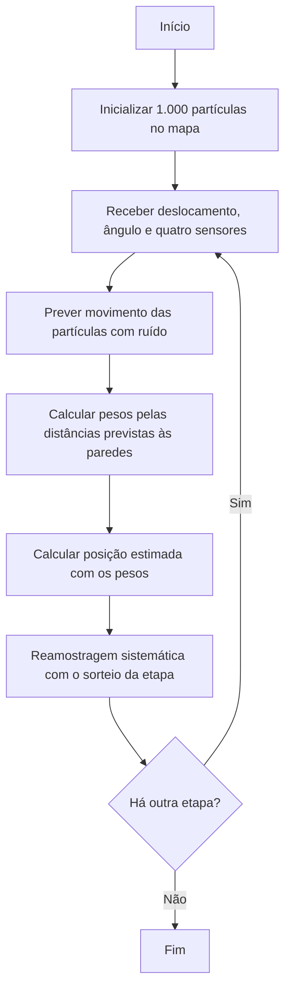
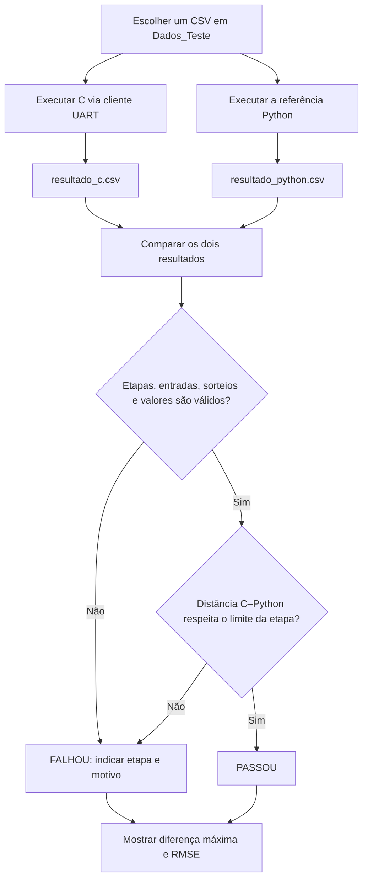

# Funcionamento e validação do filtro de partículas

Este documento separa o funcionamento de **uma etapa do filtro** do procedimento usado para **comparar a implementação C com a referência Python**. Os diagramas Mermaid podem ser visualizados no GitHub.

## 1. Funcionamento do filtro

O mapa mede 10 × 8 m e cada execução começa com 1.000 partículas. A inicialização e o ruído do movimento usam geradores reproduzíveis entre C e Python. No firmware, as coordenadas persistentes são compactadas em 12 bits por eixo para reduzir o uso de SRAM; durante os cálculos, cada partícula é representada por coordenadas `float`.

A **estimativa é calculada antes da reamostragem**. A população reamostrada será usada na etapa seguinte. No C, a reamostragem ocorre dentro de `particle_filter.c`: cada peso é recalculado e dividido pela soma total antes de entrar no acumulado, sem armazenar um vetor de pesos. Na referência Python, ela usa `systematic_resample` do FilterPy com pesos normalizados. Mesmo com o mesmo sorteio e a mesma escala dos pesos, diferenças de arredondamento nos pesos e nas somas acumuladas podem selecionar partículas diferentes.

## 2. Teste e validação C–Python

O objetivo deste teste é verificar a **concordância das posições estimadas** pelo C e pelo Python, não medir o erro em relação à posição real. Use exatamente o mesmo arquivo de `Dados_Teste/` nos dois programas. Para o C, `comunicacao_uart.py` envia cada medição e o sorteio da reamostragem à placa ou ao Renode e grava `Resultados/resultado_c.csv`. O Python processa as mesmas medições, reproduz a sequência de sorteios e grava `Resultados/resultado_python.csv`.

Em cada etapa, o comparador calcula a distância euclidiana entre as estimativas:

`d = sqrt((x_C - x_Python)^2 + (y_C - y_Python)^2)`

O critério numérico é `d ≤ 0,00001 m` (10 micrômetros) **na primeira etapa** e `d ≤ 0,01 m` (1 cm) **nas demais**. O comparador também confere quantidade e ordem das etapas, entradas e sorteios iguais, posições dentro do mapa e posições medidas compatíveis com os sensores, admitindo 1 micrômetro de diferença por arredondamento da UART. Qualquer falha torna o resultado geral `FALHOU`.

A **diferença máxima** e o **RMSE** resumem o comportamento do cenário, mas o RMSE não decide a aprovação: uma etapa muito divergente poderia ser escondida pela média das demais. O desvio padrão das diferenças não substitui esse critério, pois pode ser pequeno mesmo quando todas as diferenças são grandes. Os limites comparam as implementações; não afirmam precisão absoluta de localização nem garantem aprovação em qualquer cenário.

## Como reproduzir

1. Escolha um cenário, por exemplo `Dados_Teste/cenario_60_etapas.csv`.
2. Com o firmware ativo na placa ou no Renode, execute `.\executar_teste.ps1 -Cenario 60 -Modo Renode` na raiz do projeto (troque o modo e informe `-Porta` para a placa).
3. O script executa `comunicacao_uart.py`, `particle_filter.py` e `comparar_resultados.py` em sequência com o mesmo cenário.

Os arquivos em `Resultados/` são sobrescritos a cada execução. Portanto, gere **ambos** novamente antes de comparar outro cenário. Para comandos completos da placa e do Renode, consulte o [README](../README.md).
