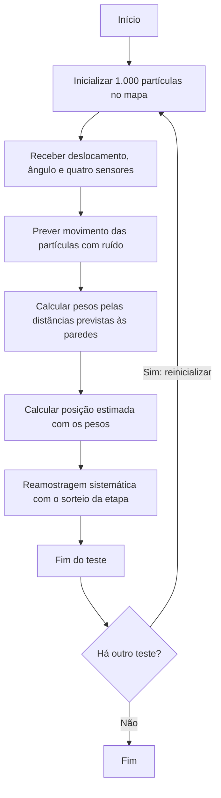
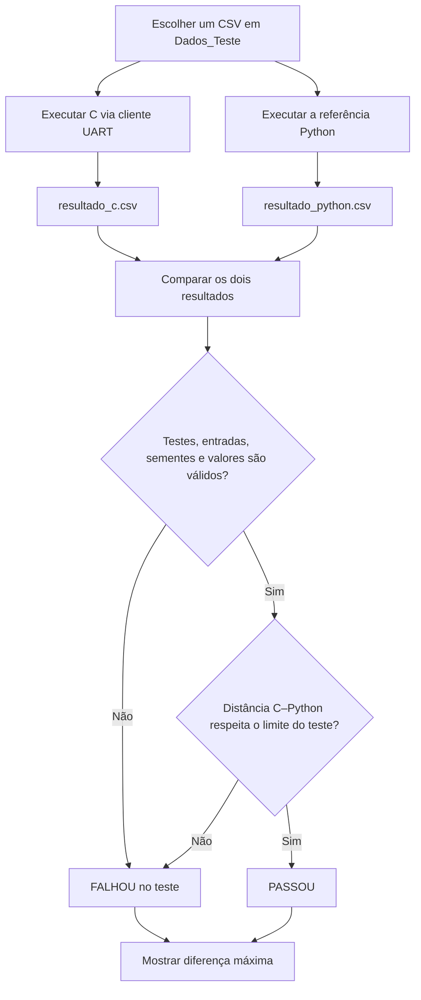

# Funcionamento e validação do filtro de partículas

Este documento separa o funcionamento de **uma etapa do filtro** do procedimento usado para **comparar a implementação C com a referência Python**. Os diagramas Mermaid podem ser visualizados no GitHub.

## 1. Funcionamento do filtro

O mapa mede 10 × 8 m e cada teste começa com 1.000 partículas. A inicialização e o ruído do movimento usam geradores reproduzíveis entre C e Python. No firmware, as coordenadas persistentes são compactadas em 12 bits por eixo para reduzir o uso de SRAM; durante os cálculos, cada partícula é representada por coordenadas `float`. Cada teste executa somente a primeira etapa do filtro.

Uma única medição (deslocamento, ângulo e quatro sensores) é usada em todos os testes de uma execução. No modo manual, ela é solicitada uma vez; na geração automática, é sorteada uma vez. As sementes variam entre testes e são iguais entre C e Python para cada teste, permitindo avaliar diferentes inicializações com a mesma entrada.

A **estimativa é calculada antes da reamostragem**. A reamostragem ainda ocorre, mas sua população não é reaproveitada: o teste seguinte começa com partículas novas. No C, o ponto inicial é sorteado pelo gerador do próprio filtro em `particle_filter.c`: cada peso é recalculado e dividido pela soma total antes de entrar no acumulado, sem armazenar um vetor de pesos. Na referência Python, `systematic_resample` do FilterPy usa seu próprio sorteio e pesos normalizados. Os sorteios e as partículas selecionadas podem ser diferentes; isso não afeta a estimativa anterior à reamostragem. O teste de uma etapa não verifica a igualdade das populações reamostradas.

## 2. Teste e validação C–Python

O objetivo é verificar a **concordância das posições estimadas** pelo C e pelo Python, não medir o erro em relação à posição real. Use exatamente o mesmo arquivo de `Dados_Teste/` nos dois programas. O cenário possui apenas uma linha de dados, além do cabeçalho, e sua única medição é repetida N vezes. Para o C, `comunicacao_uart.py` gera uma semente aleatória de 32 bits em cada teste, envia `RESET,semente`, depois a medição à placa ou ao Renode, e grava `Resultados/resultado_c.csv`, incluindo a semente. O Python lê as sementes desse resultado, confere a entrada e a quantidade de testes e reinicializa suas partículas antes de cada medição. Assim, reproduz a inicialização e o ruído de cada teste e grava `Resultados/resultado_python.csv`. O cenário mantém `teste=1`; nos resultados, a coluna `teste` identifica cada repetição de 1 a N. O comando UART executa sempre a etapa 1.

A semente varia entre testes e execuções, mas fica registrada para reprodução. O comparador verifica se as sementes coincidem. O ponto de reamostragem é gerado separadamente por C e FilterPy e não é enviado pela UART nem registrado nos CSVs. Execute o cliente C antes da referência e gere novamente resultados antigos com o formato atual. O firmware deve ser recompilado para usar o protocolo atualizado.

Em cada teste, o comparador calcula a distância euclidiana entre as estimativas:

`d = sqrt((x_C - x_Python)^2 + (y_C - y_Python)^2)`

O critério numérico padrão é `d = 0 m` **em todos os testes**, pois todos executam apenas a primeira etapa. As estimativas gravadas nos CSVs devem ser exatamente iguais; diferenças não nulas fazem o teste falhar. Isso exige igualdade na resolução dos arquivos, não dos valores internos antes da conversão. O comparador também confere quantidade e ordem dos testes, entradas e sementes iguais, posições dentro do mapa e posições medidas compatíveis com os sensores, admitindo 1 micrômetro de diferença por arredondamento da UART. Cada teste recebe seu próprio `PASSOU` ou `FALHOU`, sem exibir os motivos; não há veredito final para o conjunto. Testes ausentes em um dos resultados recebem `FALHOU`. O comparador e o executor retornam código `0` quando concluem o procedimento, inclusive com testes reprovados. O código `1` sinaliza que um erro ou cancelamento impediu a conclusão; os resultados individuais continuam determinando a concordância entre C e Python.

A **diferença máxima** resume o comportamento do cenário e é apenas informativa. Cada teste é avaliado individualmente pela diferença em relação à tolerância, além das verificações de consistência descritas acima. O limite compara as implementações; não afirma precisão absoluta de localização nem garante aprovação em qualquer cenário.

## Como reproduzir

Para executar as partes separadamente, use `py .\Scripts\executar_algoritmo_c.py`, depois `py .\Scripts\executar_algoritmo_python.py` e, por fim, `py .\Scripts\executar_comparacao.py` (ou substitua `py` por `python` ou `python3`). O primeiro oferece a seleção de entradas e destino; o segundo reutiliza por padrão as entradas e sementes do resultado C; o terceiro apenas compara os CSVs existentes. O executor completo continua disponível em `Scripts/executar_teste.py`.

Ao final da comparação, são exibidos os totais de testes que passaram e falharam. Cada teste conta uma única vez; resultados ausentes também entram no total de falhas.

Execute `py .\Scripts\executar_teste.py` (ou use `python` ou `python3`) para abrir o menu: entrada manual, CSV existente ou geração automática. Escolha também Renode ou placa. Uma única entrada manual é solicitada ou uma única entrada automática é sorteada, salva em um CSV exclusivo de `Dados_Teste/` e utilizada N vezes pelos dois programas. O gerador usa sensores ideais coerentes com o mapa de 10 × 8 m, deslocamento de 0 a 2 m e origem e destino dentro do mapa. As sementes de cada teste ficam no resultado C para reprodução pela referência. O menu permite escolher N; por comando, use `--testes N`. Sem essa opção, o executor C pergunta a quantidade, sem deduzi-la do nome do cenário.

Para gerar entradas sem o menu, use `py .\Scripts\executar_teste.py --gerar-testes 20`. Para entrada manual direta, use `--manual`. Para um CSV já existente, mantenha o fluxo abaixo:

Os cenários manuais e os gerados automaticamente usam `cenario_1.csv`, `cenario_2.csv`, `cenario_3.csv` etc., compartilhando a mesma sequência. O número identifica apenas o cenário, não a quantidade de testes. Arquivos existentes são preservados. Use `--cenario 1`, por exemplo, para selecionar `cenario_1.csv`. O cenário versionado é `cenario_exemplo.csv`.

1. Escolha um cenário, por exemplo `Dados_Teste/cenario_exemplo.csv`, e a quantidade desejada de testes independentes de uma etapa.
2. Com o firmware ativo na placa ou no Renode, execute `py .\Scripts\executar_teste.py --cenario cenario_exemplo --testes 20 --modo renode` na raiz do projeto (ou use `python` ou `python3`; para a placa, use `--modo placa --porta COM3`, conforme a porta do PC).
3. O script executa `comunicacao_uart.py`, `particle_filter.py` e `comparar_resultados.py` em sequência com o mesmo cenário.

Os arquivos em `Resultados/` são sobrescritos a cada execução. Portanto, gere **ambos** novamente antes de comparar outro cenário. Para comandos completos da placa e do Renode, consulte o [README](../README.md).
