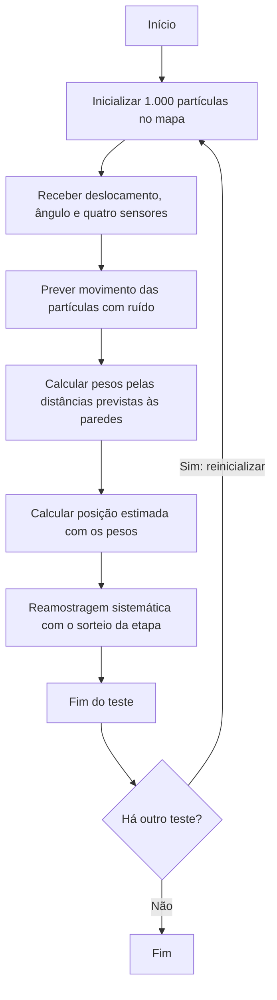
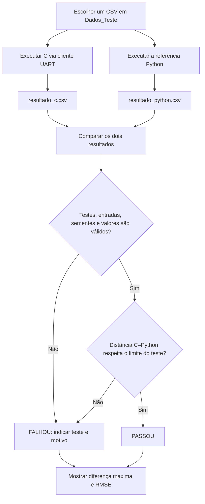

# Funcionamento e validação do filtro de partículas

Este documento separa o funcionamento de **uma etapa do filtro** do procedimento usado para **comparar a implementação C com a referência Python**. Os diagramas Mermaid podem ser visualizados no GitHub.

## 1. Funcionamento do filtro

O mapa mede 10 × 8 m e cada teste começa com 1.000 partículas. A inicialização e o ruído do movimento usam geradores reproduzíveis entre C e Python. No firmware, as coordenadas persistentes são compactadas em 12 bits por eixo para reduzir o uso de SRAM; durante os cálculos, cada partícula é representada por coordenadas `float`. Cada teste executa somente a primeira etapa do filtro.

A **estimativa é calculada antes da reamostragem**. A reamostragem ainda ocorre, mas sua população não é reaproveitada: o teste seguinte começa com partículas novas. No C, o ponto inicial é sorteado pelo gerador do próprio filtro em `particle_filter.c`: cada peso é recalculado e dividido pela soma total antes de entrar no acumulado, sem armazenar um vetor de pesos. Na referência Python, `systematic_resample` do FilterPy usa seu próprio sorteio e pesos normalizados. Os sorteios e as partículas selecionadas podem ser diferentes; isso não afeta a estimativa anterior à reamostragem. O teste de uma etapa não verifica a igualdade das populações reamostradas.

## 2. Teste e validação C–Python

O objetivo é verificar a **concordância das posições estimadas** pelo C e pelo Python, não medir o erro em relação à posição real. Use exatamente o mesmo arquivo de `Dados_Teste/` nos dois programas. Cada linha é um teste independente de uma etapa. Para o C, `comunicacao_uart.py` gera uma semente aleatória de 32 bits, envia `RESET,semente`, depois a medição à placa ou ao Renode, e grava `Resultados/resultado_c.csv`, incluindo a semente. O Python lê as sementes desse resultado, confere as entradas e reinicializa suas partículas antes de cada medição. Assim, reproduz a inicialização e o ruído de cada teste e grava `Resultados/resultado_python.csv`. A coluna `teste` dos CSVs de entrada e resultado identifica o teste; o comando UART executa sempre a etapa 1.

A semente varia entre testes e execuções, mas fica registrada para reprodução. O comparador verifica se as sementes coincidem. O ponto de reamostragem é gerado separadamente por C e FilterPy e não é enviado pela UART nem registrado nos CSVs. Execute o cliente C antes da referência e gere novamente resultados antigos com o formato atual. O firmware deve ser recompilado para usar o protocolo atualizado.

Em cada teste, o comparador calcula a distância euclidiana entre as estimativas:

`d = sqrt((x_C - x_Python)^2 + (y_C - y_Python)^2)`

O critério numérico é `d ≤ 0,00001 m` (10 micrômetros) **em todos os testes**, pois todos executam apenas a primeira etapa. O comparador também confere quantidade e ordem dos testes, entradas e sementes iguais, posições dentro do mapa e posições medidas compatíveis com os sensores, admitindo 1 micrômetro de diferença por arredondamento da UART. Qualquer falha torna o resultado geral `FALHOU`.

A **diferença máxima** e o **RMSE** resumem o comportamento do cenário, mas o RMSE não decide a aprovação: um teste muito divergente poderia ser escondido pela média dos demais. O desvio padrão das diferenças não substitui esse critério, pois pode ser pequeno mesmo quando todas as diferenças são grandes. O limite compara as implementações; não afirma precisão absoluta de localização nem garante aprovação em qualquer cenário.

## Como reproduzir

1. Escolha um cenário, por exemplo `Dados_Teste/cenario_20_testes.csv`, com 20 testes independentes de uma etapa.
2. Com o firmware ativo na placa ou no Renode, execute `py .\executar_teste.py --cenario 20 --modo renode` na raiz do projeto (ou use `python` ou `python3`; para a placa, use `--modo placa --porta COM3`, conforme a porta do PC).
3. O script executa `comunicacao_uart.py`, `particle_filter.py` e `comparar_resultados.py` em sequência com o mesmo cenário.

Os arquivos em `Resultados/` são sobrescritos a cada execução. Portanto, gere **ambos** novamente antes de comparar outro cenário. Para comandos completos da placa e do Renode, consulte o [README](../README.md).
